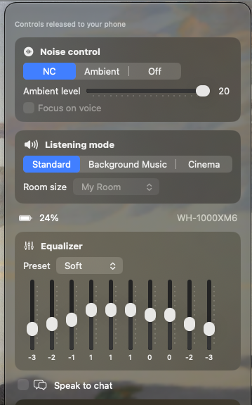
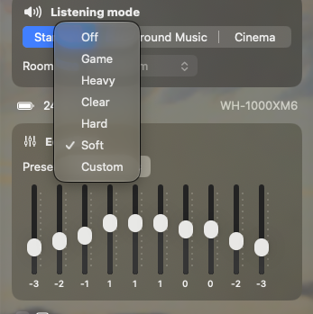
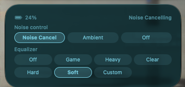
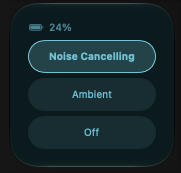

# XM6-Connect

XM6-Connect is a small, open-source macOS app for controlling Sony WH-1000XM6 headphones from your
Mac over Bluetooth Classic. You get a menu-bar popover, a desktop widget and a command-line
tool, `xm6ctl`. A background agent owns the Bluetooth connection, and it
connects to the headphones only while you are using them. The rest of the time your phone and
Sony's app can use them as usual.

> **Not affiliated with Sony.** Sony and WH-1000XM6 are trademarks of Sony Group Corporation.
> XM6-Connect is an independent project. Sony does not make, endorse or support it.

<p align="center">
  
  &nbsp;
  
</p>
<p align="center">
  
</p>
<p align="center">
  
</p>

## Features

- **Noise control:** Noise Cancelling, Ambient Sound or Off; an ambient level from 1 to 20; and
  Focus on voice.
- **Equalizer:** the Off, Game, Heavy, Clear, Hard and Soft presets, plus a 10-band Custom curve
  with each band from -6 to +6.
- **Speak-to-chat** on or off.
- **Listening mode:** Standard, Background Music (with room size My Room, Living Room or Cafe) or
  Cinema.
- **Multipoint:** lists the devices the headphones are paired with and lets you switch which
  connected device is the playback source.
- **Battery:** level and charging state.
- **Menu-bar popover** with all of the controls above. A control you change keeps showing your new
  value until the headphones confirm it. If they never confirm it, the control goes back to what
  the headphones last reported, about 10 seconds later.
- **Desktop widget** in small and medium sizes. Both show the battery level and buttons for the
  three noise-control modes, with the current one highlighted. The medium size also names the
  current mode and has the equalizer presets. The widget dims when its information is more than
  20 minutes old or the last connection attempt failed.
- **`xm6ctl`**, a command-line tool for scripts and shortcuts (see [xm6ctl](#xm6ctl)).

## Requirements

- macOS 26 or later.
- A Mac with Apple silicon. The build script compiles the app and widget for `arm64` only, so Intel
  Macs are not supported.
- The Xcode Command Line Tools (or Xcode) with a Swift 6 toolchain and the macOS 26 SDK. Xcode
  itself is not needed.
- A Sony WH-1000XM6 paired with the Mac in **System Settings → Bluetooth**. On its first
  connection the agent looks for a paired device whose name contains `WH-1000XM6`.

## Build, install, uninstall

There are no prebuilt downloads. You build the app from source.

```sh
git clone https://github.com/mbieniooo/XM6-Connect.git
cd XM6-Connect

bash scripts/run_tests.sh     # automated tests; no headphones needed
bash scripts/build_app.sh     # builds dist/XM6-Connect.app
bash scripts/install.sh       # tests, builds, installs and starts it
```

`scripts/build_app.sh` builds `dist/XM6-Connect.app`, which contains three parts:

- the menu-bar app;
- the background agent, `Contents/MacOS/XM6ConnectAgent`;
- the widget extension, which provides the desktop widget.

It also copies the license files into the app and checks the signature at the end.

**Code signing.** By default the app is signed ad hoc. To sign with an identity from your keychain
instead, set the `CODESIGN_IDENTITY` environment variable to that identity's name:

```sh
CODESIGN_IDENTITY="My Code Signing Cert" bash scripts/install.sh
```

A self-signed code-signing certificate made in Keychain Access is enough, and you do not need an
Apple developer account. Signing with a real identity matters because of the Bluetooth permission
(see [First run](#first-run)).

**Install.** `scripts/install.sh` does the following:

1. Runs the tests and the build, and stops if either fails.
2. Stops any running copy.
3. Installs the app to `~/Applications/XM6-Connect.app` and registers its widget extension.
4. Installs two LaunchAgents in `~/Library/LaunchAgents`, which turns **Start at login** on:
   - `io.github.mbieniooo.xm6connect.agent` keeps the agent running.
   - `io.github.mbieniooo.xm6connect.login` opens the menu-bar app at login.
5. Starts the agent and opens the app.

**Uninstall.**

```sh
bash scripts/uninstall.sh           # keeps settings in ~/Library/Application Support/XM6Connect
bash scripts/uninstall.sh --purge   # also deletes that folder
```

The uninstaller stops the app, the agent and the widget, removes both LaunchAgents, and deletes
`~/Applications/XM6-Connect.app`. It does not touch the Bluetooth permission. If you want to remove
that too, do it in System Settings → Privacy & Security → Bluetooth.

## First run

The first time the agent uses Bluetooth, macOS asks whether XM6-Connect may use Bluetooth. Allow
it, or the agent cannot reach the headphones.

macOS ties that permission to the app's code signature. An ad-hoc signature changes with every
build, so **every rebuild of an ad-hoc-signed app asks for the permission again**. If nobody
answers that prompt, the agent waits and the controls stay empty. If you rebuild often, sign with
`CODESIGN_IDENTITY` (see above): with a real identity the permission carries over from one build to
the next.

After that, click the headphones icon in the menu bar. Opening the popover tells the agent to
connect, so the headphones' current settings appear after a moment. To add the widget, use your
desktop's widget gallery, where it is called "XM6-Connect".

## Sharing the headphones with your phone

The WH-1000XM6 accepts only **one** control session at a time. While the Mac holds it, Sony's phone
app cannot connect, and while the phone holds it, the Mac cannot. XM6-Connect is designed to hold
the session as little as possible:

- The agent connects when you change a setting (in the popover, the widget, the control or
  `xm6ctl`), open the popover, or run `xm6ctl refresh` or `xm6ctl reconnect`. `xm6ctl status` only
  reads the agent's last known state. The agent **releases the session about 20 seconds after the
  last command.** It also releases it when the Mac sleeps or the
  screen locks.
- About every 5 minutes while the session is released, the agent briefly connects to read the
  current state, then releases it again.
- If the agent cannot open the session because something else (usually the phone app) holds it,
  it **stands down**. It waits about 1 minute, then 3, then 10, and only then tries again. It never
  disconnects the other client.
- The popover shows who has control, for example "Controls released to your phone" or "Controls
  yielded to another app".
- `xm6ctl yield [seconds]` hands control over on purpose. The default is 10 minutes.
  `xm6ctl hold on` keeps the session held, which keeps the phone app out, until `xm6ctl hold off`.

## xm6ctl

`xm6ctl` talks to the running agent. `install.sh` does not install it, so build it yourself and run
it from the build folder:

```sh
swift build -c release --product xm6ctl
.build/release/xm6ctl status
```

```text
usage: xm6ctl status [--json] | refresh | yield [seconds] | hold on|off | mode nc|ambient|off
            | cycle | ambient 1-20 | focus on|off | listening standard|bgm|cinema
            | bgm-room small|middle|large | eq preset <name|code> | eq bands <10 ints>
            | stc on|off | playback <name|mac> | reconnect
```

| Command | Effect |
|---|---|
| `status [--json]` | Prints the agent's current state. `--json` prints only the JSON. |
| `refresh` | Reads the state from the headphones again. |
| `mode nc\|ambient\|off` | Sets the noise-control mode. |
| `cycle` | Steps Noise Cancelling → Ambient → Off. |
| `ambient 1-20` | Switches to Ambient at that level. |
| `focus on\|off` | Turns Focus on voice on or off. |
| `listening standard\|bgm\|cinema` | Sets the listening mode. |
| `bgm-room small\|middle\|large` | Sets the Background Music room size (My Room, Living Room, Cafe). |
| `eq preset <name\|code>` | Selects a preset by name (any case) or by numeric code 0-255. |
| `eq bands <10 ints>` | Sets the Custom curve. Each value is from -6 to 6. |
| `stc on\|off` | Turns speak-to-chat on or off. |
| `playback <name\|mac>` | Makes a connected multipoint device the playback source. |
| `yield [seconds]` | Releases control and stays away for that long (default 600 seconds). |
| `hold on\|off` | Keeps the control session held, or goes back to releasing it when idle. |
| `reconnect` | Connects to the headphones again now. |

Exit status: `0` on success. `1` if the agent is not running, does not reply within 5 seconds, or
rejects the command (the reason goes to stderr). `64` for a usage error.

## Known limitations

- Only the WH-1000XM6 is supported, and only one headset at a time. The protocol details in
  [docs/PROTOCOL.md](docs/PROTOCOL.md) come from one headset model and firmware. Other models and
  firmware versions may behave differently.
- The Mac and Sony's phone app cannot control the headphones at the same moment (see
  [Sharing the headphones](#sharing-the-headphones-with-your-phone)). A change made on the Mac can
  take a few seconds while the agent connects.
- When the agent is not connected, the popover, widget and control show the last state it read.
  The agent refreshes that state about every 5 minutes. The widget dims once that state is more
  than 20 minutes old.
- The agent finds the headphones by their Bluetooth name the first time, so a headset renamed so
  that its name no longer contains `WH-1000XM6` is not found on first run.
- You have to build the app yourself. It is not notarized, and an ad-hoc-signed build asks for
  Bluetooth permission again after every rebuild.
- Apple silicon only.
- There is no Control Center control. A Control Center button can only act through an App
  Intent, whose metadata is produced by a tool that ships with Xcode rather than with the
  Command Line Tools this project builds with, so such a button does nothing when clicked.

## Troubleshooting

**The popover says "Agent not running".** The menu-bar app cannot reach the agent's socket at
`~/Library/Application Support/XM6Connect/agent.sock`.

- Use the button in the popover. **Start agent** restarts an installed agent. **Turn on** turns
  Start at login back on and starts the agent.
- To check from Terminal:
  ```sh
  launchctl print gui/$(id -u)/io.github.mbieniooo.xm6connect.agent
  ```
- If you moved the app, the popover footer says so. Turn **Start XM6-Connect at login** on again to
  point the LaunchAgents at the new location.
- Running `bash scripts/install.sh` again reinstalls everything.

**Bluetooth permission was denied, or the controls never fill in after a rebuild.**

- Open System Settings → Privacy & Security → Bluetooth and allow XM6ConnectAgent (the background
  agent is the part that talks to the headphones).
- After an ad-hoc-signed rebuild, look for a new permission prompt that is still waiting for an
  answer.
- The agent's log can help:
  ```sh
  log stream --predicate 'subsystem == "io.github.mbieniooo.xm6connect"'
  ```

**"No paired WH-1000XM6 found" or "WH-1000XM6 is not connected to this Mac".**

- Pair the headphones in System Settings → Bluetooth and connect them to the Mac.
- With multipoint, the Mac must be one of the headset's connected devices.
- The agent retries every minute. Use **Reconnect** in the popover, or `xm6ctl reconnect`, to try
  at once.

**"Controls yielded to another app".** Another client, usually Sony's phone app, holds the
control session. Close that app's connection to the headphones, then use **Reconnect**. Otherwise
the agent tries again by itself after its wait.

**The widget or control does not appear in the gallery.** Run `bash scripts/install.sh` again. It
re-registers the widget extension.

**Reporting a protocol problem.** The agent can record every frame it sends and receives:

```sh
defaults write XM6ConnectAgent protocolLoggingEnabled -bool true
```

The switch takes effect within about a second, without restarting anything. Reproduce the problem,
then turn it off again with `-bool false`. The log is
`~/Library/Application Support/XM6Connect/protocol.log`, readable only by your user, and kept under
about 2 MB. It contains your headphones' Bluetooth address and name, so remove them before
attaching an excerpt to an issue.

## Protocol

[docs/PROTOCOL.md](docs/PROTOCOL.md) describes the part of Sony's headphone protocol that
XM6-Connect uses: the transport, the frame format, the handshake, and every message it sends or
reads.

## Credits

- The [Gadgetbridge](https://gadgetbridge.org) project's open-source work on Sony headphones
  informed this project.
- Parts of `SonyHeadphonesKit` (the Bluetooth RFCOMM transport, the controller's connection and
  command-queue code, and the model types) started from
  [xm6-control](https://github.com/ruimartins23/xm6-control) by Rui Martins, which is MIT licensed.
  Its license notice is in [THIRD_PARTY/xm6-control-LICENSE](THIRD_PARTY/xm6-control-LICENSE) and
  is also copied into the built app.

## License

XM6-Connect is released under the [MIT License](LICENSE). Copyright (c) 2026 Mieszko Bienias.
